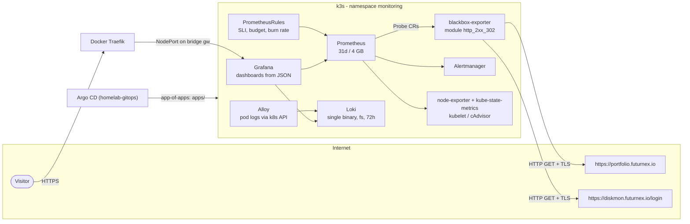
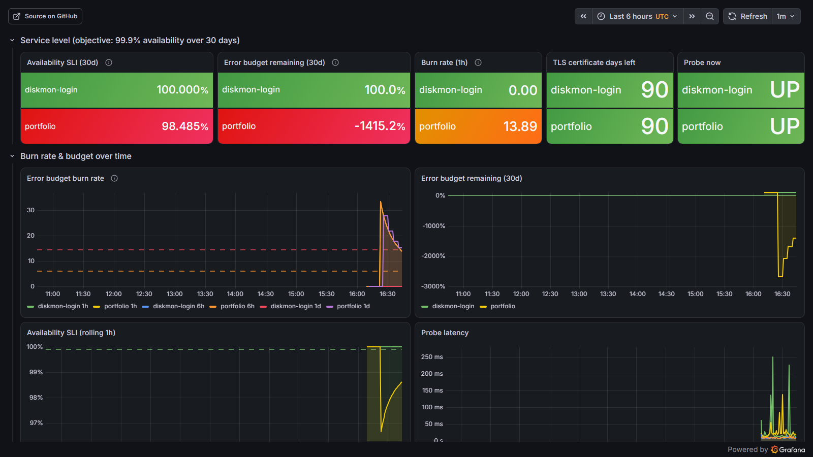
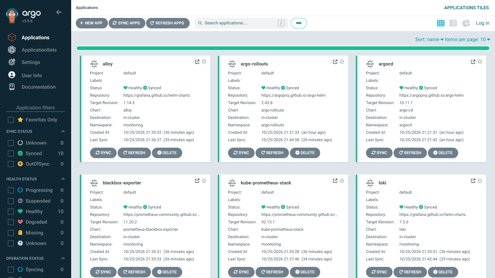

# observability-slo-stack

[](https://github.com/bhavishyajain545/observability-slo-stack/actions/workflows/ci.yaml)

**SLOs as code** on a single-node k3s cluster: Prometheus, Alertmanager, Grafana,
Loki and Grafana Alloy, plus blackbox-exporter probing two public websites.
Availability SLIs, error budgets, multi-window multi-burn-rate alerts and the
Grafana dashboards all live in this repo and are deployed by Argo CD from
[homelab-gitops](https://github.com/bhavishyajain545/homelab-gitops).

**Live:** https://grafana.futurnex.io - opens on the *SLO overview* dashboard,
no login needed (anonymous Viewer).

## Architecture



| Argo CD Application | Source | Wave |
|---|---|---|
| `kube-prometheus-stack` | chart 92.13.1 + `values/kube-prometheus-stack.yaml` | 0 |
| `loki` | chart 7.5.0 (Loki 3.6) + `values/loki.yaml` | 1 |
| `blackbox-exporter` | chart `prometheus-blackbox-exporter` 11.20.2 + `values/blackbox-exporter.yaml` | 1 |
| `alloy` | chart 1.14.3 (Alloy 1.21) + `values/alloy.yaml` | 2 |
| `slo-config` | `config/` (kustomize): Probes, PrometheusRules, dashboard ConfigMaps, folder guard | 3 |

Promtail is end-of-life, so log shipping uses **Grafana Alloy** with
`loki.source.kubernetes` (reads logs through the API, no hostPath mounts).

## SLOs

| SLO | SLI | Objective | Window |
|-----|-----|-----------|--------|
| `portfolio` | share of successful probes of `https://portfolio.futurnex.io` (HTTP 200/302, valid TLS, < 10 s) | 99.9% | 30 days |
| `diskmon-login` | same for `https://diskmon.futurnex.io/login` (reachability of the login page only) | 99.9% | 30 days |

Only the two public URLs and the VPS / k3s itself are monitored - nothing behind
those sites is scraped.

### The math, briefly

- **SLI** = good events / valid events = `avg_over_time(probe_success[w])`
  (each probe every 30 s is one event).
- **Error budget** = 1 - objective = **0.1%** -> ~43 minutes of failed probes per 30 days.
- **Burn rate** = error ratio over a window / error budget. A burn rate of 1 spends
  exactly the whole budget in 30 days; 14.4 spends 2% of it in one hour.
- **Budget remaining** = 1 - error ratio(30d) / error budget.

Recording rules (`config/rules/slo-recording.yaml`) compute
`slo:sli_error:ratio_rate{5m,30m,1h,2h,6h,1d,3d,30d}`, `slo:burn_rate:<w>`,
`slo:error_budget_remaining:ratio` and `slo:tls_cert_days_left` per `slo` label.

### Multi-window, multi-burn-rate alerts

From the Google SRE Workbook. The long window shows the burn is significant; the
short window (1/12 of it) lets the alert clear soon after recovery.

| Alert | Severity | Condition | Budget spent at trigger |
|-------|----------|-----------|-------------------------|
| `SLOErrorBudgetBurnFast` | critical | burn > 14.4 over 1h **and** 5m | 2% |
| | | burn > 6 over 6h **and** 30m | 5% |
| `SLOErrorBudgetBurnSlow` | warning | burn > 3 over 1d **and** 2h | 10% |
| | | burn > 1 over 3d **and** 6h | 10% |
| `SLOErrorBudgetExhausted` | warning | budget remaining <= 0 | 100% |
| `SLOProbeMissing` | warning | no `probe_success` for a target for 10 m | - |
| `TLSCertificateExpiringSoon` / `...Critical` | warning / critical | cert expires in < 14 / < 7 days | - |

Rules are unit-tested with `promtool test rules` (`tests/slo-rules.test.yaml`):
a simulated 15-minute outage must page via the fast-burn alert, a healthy target
must stay silent, and a 10-day certificate must raise the TLS warning.

## Dashboards

Provisioned from JSON in `config/dashboards/` by the Grafana sidecar
(`grafana_dashboard: "1"` label, folder from the `grafana_folder` annotation):

- **SLO overview** (folder *SLO*, public) - 30-day SLI, error budget remaining,
  1h burn rate, TLS days left, probe up/down, burn rate 1h/6h/1d over time,
  budget trend, rolling 1h SLI, probe latency incl. TLS phase, HTTP status, firing
  SLO alerts, log volume per namespace from Loki.
- **VPS node** (folder *Platform*, admin-only) - CPU, memory, disk, network, load,
  uptime, per-namespace memory/CPU, filesystem usage and a Loki warnings/errors panel.

### Screenshots (to add)

- [ ] `docs/slo-overview.png` - SLO overview, last 24 h
- [x] `docs/burn-rate.png` - burn rate during a **real** incident: repeated portfolio redeploys caused ~30 s of downtime each (the container stayed `health: starting` for a full 30 s healthcheck interval, so Traefik had no backend). The 1 h burn rate crossed the fast-burn threshold; the fix was a 2 s `start_interval` on the healthcheck, cutting redeploy downtime to ~2.5 s.

  
- [ ] `docs/vps-node.png` - VPS node dashboard
- [x] `docs/argocd-apps.png` - the Applications in Argo CD

  

## Access model

- Grafana anonymous access is **org role Viewer**: dashboards only. Viewers cannot
  use Explore (`viewers_can_edit = false`), edit, create snapshots, or reach admin
  pages. Login form stays for the admin.
- The *Platform* folder is restricted to admins by `config/grafana-folder-guard.yaml`,
  a small CronJob that re-applies the folder permission (Grafana OSS can't
  provision permissions and this Grafana is stateless - everything comes from Git).
- Admin password: random, created by `scripts/create-secrets.sh` into the
  `grafana-admin` Secret and `/root/homelab-secrets/grafana-admin.txt` (600) on the
  server. Never in Git.
- **Trade-off:** Grafana OSS has no per-datasource permissions, so a Viewer can
  send arbitrary *read* queries to Prometheus/Loki through the API. That's why
  only platform data is collected: node/k8s metrics, the two probes, and logs from
  the `argocd`, `argo-rollouts`, `rollouts-demo`, `monitoring` and `kube-system`
  namespaces (Alloy drops everything else).

## Resource budget

Requests/limits are set on every component. Measured on the live node the whole
cluster (k3s + Argo CD + this stack) uses roughly 3.5-4 GB RAM. Prometheus keeps
31 days (needed for the 30-day SLO window) capped at 4 GB on a 6 Gi PVC; Loki
keeps 72 hours on 5 Gi.

## Run the checks locally

```bash
# needs promtool, yq (v4), jq
./scripts/check.sh
```

CI (`.github/workflows/ci.yaml`) runs `promtool check rules`, `promtool test rules`,
dashboard JSON validation (valid JSON, uid/title/panels, known datasource uids,
unique ids), yamllint, and kubeconform on `kustomize build config` and `apps/`.

## Runbook

1. Open *SLO overview*: which `slo`, since when, HTTP status / probe latency.
2. `curl -sI <url>` from outside; check the Traefik container logs for the router.
3. If only TLS fails: check Traefik ACME logs (`docker logs traefik | grep -i acme`).
4. A fast burn that has stopped will clear within ~5 minutes (short window).
5. Budget exhausted: freeze risky deploys of that service until it recovers.

Alertmanager ships with a `null` receiver in this public demo; add a Slack/email
receiver in `values/kube-prometheus-stack.yaml` (`alertmanager.config`) with the
webhook stored as a Secret.

## License

[MIT](LICENSE)
